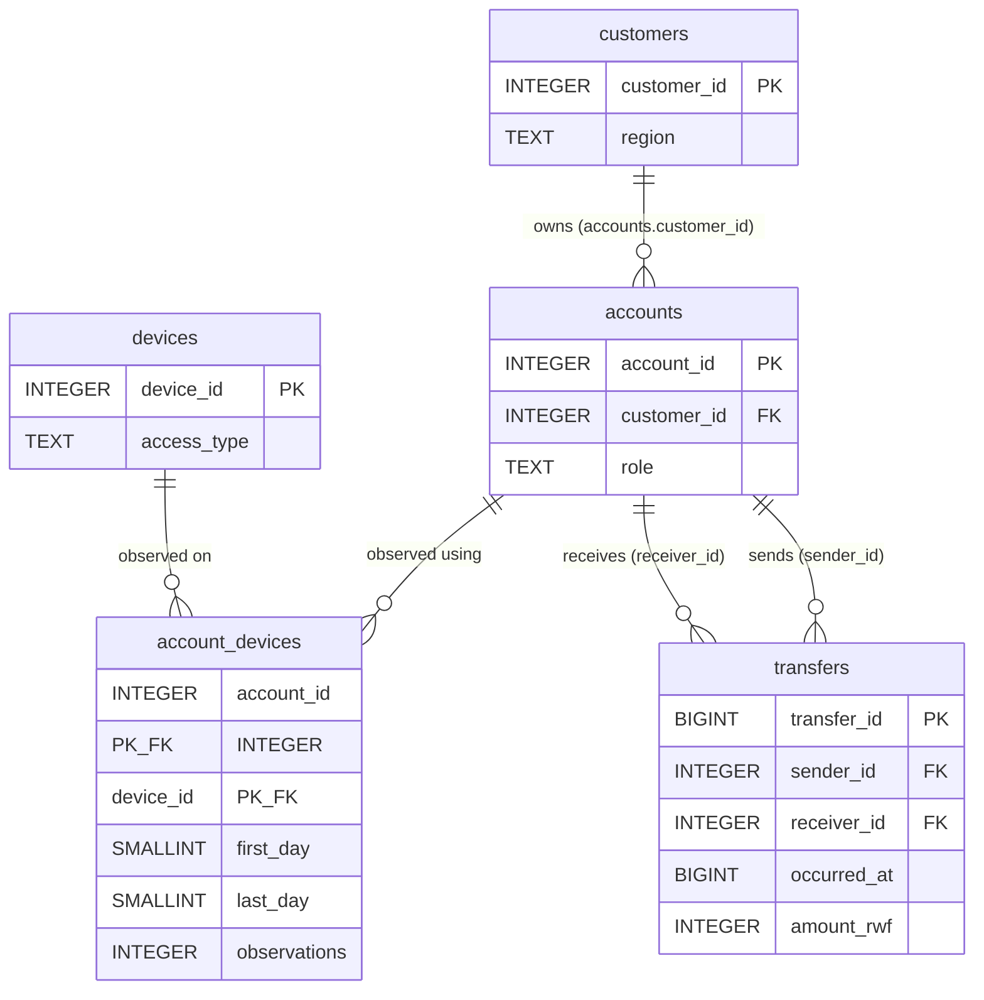
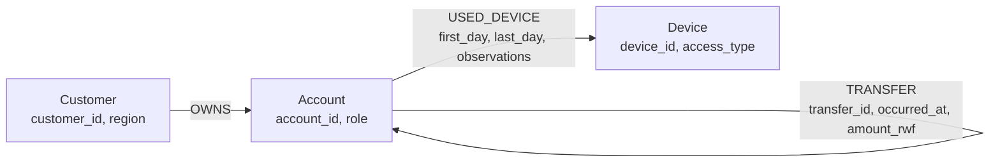

# Schemas (render the Mermaid diagrams on GitHub, then screenshot them)

## PostgreSQL (Section 2.1)

| Column | Meaning | Unit / range |
|---|---|---|
| customers.customer_id | Customer identifier | integer 1..228,000 |
| customers.region | Customer region | Kigali, Northern, Southern, Eastern, Western |
| accounts.account_id | Wallet identifier | 1..248,000 |
| accounts.customer_id | Owner of the wallet | references customers |
| accounts.role | Wallet role | person, merchant, agent |
| devices.device_id | Device identifier | 1..228,600 |
| devices.access_type | Kind of device | handset, public_terminal |
| account_devices.first_day / last_day | First and last day the account was observed on the device | inclusive day number 0..29, day 0 = 1 Sep 2026 CAT |
| account_devices.observations | Observations in that interval | positive count |
| transfers.transfer_id | Transfer identifier | 1..20,003,300 |
| transfers.sender_id / receiver_id | Wallet paying / receiving | references accounts |
| transfers.occurred_at | Time of the transfer | Unix time, seconds (UTC epoch) |
| transfers.amount_rwf | Amount moved between wallets | positive whole Rwandan francs |

## Neo4j (Section 3.1)

| Source field | Graph element |
|---|---|
| customers.customer_id, region | (:Customer {customer_id, region}) |
| accounts.account_id, role | (:Account {account_id, role}) |
| accounts.customer_id | (:Customer)-[:OWNS]->(:Account) (ID column ignored in the node file, written to owns.csv) |
| devices.device_id, access_type | (:Device {device_id, access_type}) |
| account_devices.account_id, device_id | (:Account)-[:USED_DEVICE]->(:Device) |
| account_devices.first_day, last_day, observations | properties on USED_DEVICE |
| transfers.sender_id, receiver_id | (:Account)-[:TRANSFER]->(:Account) start and end |
| transfers.transfer_id, occurred_at, amount_rwf | properties on each TRANSFER (one relationship per transfer, repeated payments preserved) |
